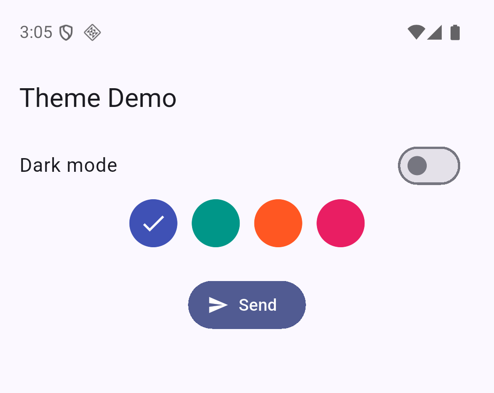
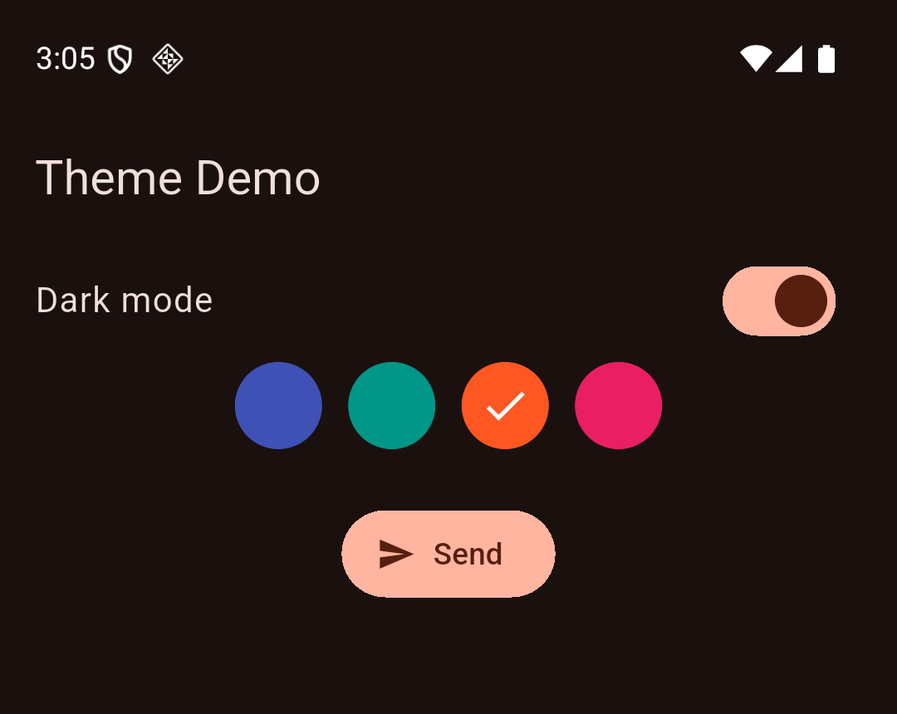

# Flutter Theme demo

A small Flutter app that restyles itself from two values: a seed colour and a dark mode flag. It switches between light and dark mode, rebuilds the whole colour palette from a single seed colour, and shows a button that picks that palette up without being given a colour.

The realistic use case is the appearance setting of any production app, where the user chooses dark mode and an accent colour and every screen follows.

| Default: light, indigo seed | Changed: dark, deep orange seed |
| --- | --- |
|  |  |

## Run it

You need the Flutter SDK (built with Flutter 3.47.2) and an Android emulator, iOS simulator or Chrome.

```bash
git clone https://github.com/owizdom/flutter-theme-demo.git
cd flutter-theme-demo
flutter pub get
flutter run
```

Run the tests with `flutter test`.

## Attribute notes

The three properties sit on consecutive lines of `MaterialApp` in `lib/main.dart` (lines 20 to 22).

| Property | Default | Changed live | Visual effect | Why a developer adjusts it |
| --- | --- | --- | --- | --- |
| `theme` | `null`. Flutter then uses a plain `ThemeData()` with its baseline purple palette | Tap a colour circle. `ColorScheme.fromSeed(seedColor: _seed)` builds a new palette | The switch, app bar and Send button all take the new colour together | One brand colour gives a full matching palette, so nobody picks every colour by hand |
| `darkTheme` | `null`. With no dark theme, the app stays on `theme` even when dark is requested | The same seed with `brightness: Brightness.dark` (the `brightness` default is `Brightness.light`) | Dark background, light text, and a lighter tone of the seed colour that stays readable | Dark mode for night use, without restyling any widget |
| `themeMode` | `ThemeMode.system`, which follows the phone's setting | Toggle the Dark mode switch to move between `ThemeMode.light` and `ThemeMode.dark` | The whole screen flips between the two themes | Lets the user override the system setting from inside the app |

## How it works

Every interaction follows the same loop: tap, `setState`, rebuild, new look.

1. `_ThemeDemoAppState` holds `_dark`, `_seed` and the list of four colour choices.
2. `build` passes them into `theme`, `darkTheme` and `themeMode` on `MaterialApp`.
3. The switch sets `_dark` and a circle sets `_seed`, both inside `setState`, so `build` runs again.
4. The Send button has an empty `onPressed` and no colour of its own. It reads its colours from the current theme, which shows that Material widgets follow the theme automatically.

## Files

- `lib/main.dart`: the whole app, 40 lines
- `test/widget_test.dart`: tests for the default state, the dark switch and the seed change
- `screenshots/`: the two images above, taken on an Android emulator
